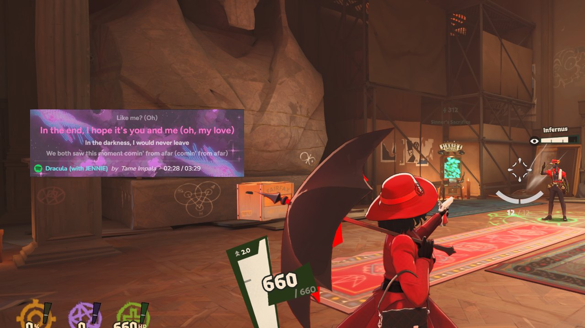
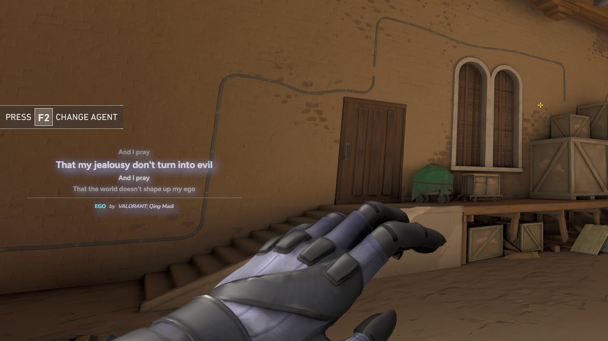

# Lyrycal

**Karaoke-style synced lyrics for whatever you're playing, over any app or game.**

Windows 10 / 11 · Free

### [⬇ Download the latest version](../../releases/latest)

  
   
  A custom look with a background image, over Deadlock

Lyrycal notices the song playing in any media player (Spotify, YouTube Music in a browser, VLC, Apple Music and others), finds time-synced lyrics for it, and shows them in a small overlay that stays on top of your games and apps. You don't have to set up each player or type song names. Play music and sing along.

## Features

- **Works with any player.** If a player shows up in Windows' media pop-up (the one beside the volume slider), Lyrycal can read it, browser tabs included.
- **Lyrics in time with the song.** The current line is highlighted as it's sung, with the lines around it shown too.
- **Stays out of your way.** The overlay is always on top and click-through, so it never takes your mouse or keyboard away from a game.
- **Fix lyrics that are off.** Shift them earlier or later in 0.2 s steps (remembered per song), switch to another version of the lyrics, or paste your own.
- **Your own `.lrc` files.** Point Lyrycal at a folder of lyrics files and it uses them before looking online.
- **Make it look your way.** Fonts, sizes, colors, background image (GIFs too), frame, shadow, spacing and which details to show, with a live preview.
- **Share your look.** Export it as a `.lyrycal` file, and double-click one from a friend to import it.
- **Light on your PC.** A small background process, and each song's lyrics take about 4 KB of disk once saved. Saved lyrics work offline.

  
   
  A minimal look with no box, over Valorant

## Install

1. Download `Lyrycal_<version>_x64-setup.exe` from the [latest release](../../releases/latest).
2. Run it. It installs for your Windows account only, so no admin rights are needed.
3. Lyrycal starts in the system tray. Play a song.

> [!NOTE]
> The installer isn't code-signed yet, so Windows may show "Windows protected your PC". Choose **More info**, then **Run anyway**. Each release lists the installer's SHA-256 checksum, so you can check your download is the real one.

Lyrycal needs Microsoft WebView2, which is built into Windows 11 and almost every Windows 10 PC. If it's missing, the installer downloads it.

To update, download and run the newer installer. Your settings and saved lyrics are kept.

## Using Lyrycal

Everything is in the tray icon's menu: **Settings…**, **Adjust lyrics**, **Move overlay**, **Hide overlay** and **Quit**.

### Keyboard shortcuts

These work from any app, including full-screen games.

| Action | Shortcut |
| --- | --- |
| Lyrics 0.2 s earlier | <kbd>Ctrl</kbd> + <kbd>Alt</kbd> + <kbd>&lt;</kbd> |
| Lyrics 0.2 s later | <kbd>Ctrl</kbd> + <kbd>Alt</kbd> + <kbd>&gt;</kbd> |
| Hide or show the overlay | <kbd>Ctrl</kbd> + <kbd>Alt</kbd> + <kbd>H</kbd> |
| Move overlay | <kbd>Ctrl</kbd> + <kbd>Alt</kbd> + <kbd>O</kbd> |
| Adjust lyrics | <kbd>Ctrl</kbd> + <kbd>Alt</kbd> + <kbd>L</kbd> |

If another app already uses one of these, Settings › General marks it.

### Your own lyrics files

In **Settings › General › Your lyrics files**, choose a folder. For each song, Lyrycal looks there first for a file saved as either:

- `Artist - Title.lrc`, or
- the song title inside a folder named after the artist, like `Artist\Album\01 - Title.lrc`.

Names are matched ignoring capitals and punctuation.

### Sharing a setup

In **Settings › General › Share your setup**, export your overlay's look as a `.lyrycal` file, background image included. To use someone else's, double-click their file or choose **Import setup…**. Lyrycal asks first, and you can undo it. Imported files are checked before anything is applied, and your position and General settings are never part of a shared setup.

## Good to know

- **Games:** the overlay shows over windowed and borderless full-screen games, which is the default for most modern games. It can't draw over exclusive full-screen; switch the game to borderless if the lyrics don't appear.
- **Where lyrics come from:** [LRCLIB](https://lrclib.net), a free, community-run database of synced lyrics, plus your own `.lrc` folder if you set one.
- **Privacy:** the only thing Lyrycal sends anywhere is the playing song's artist, title, album and length, to LRCLIB, to find its lyrics. There are no accounts and no analytics.
- **Your data:**

  | What | Where |
  | --- | --- |
  | Settings, overlay position, background images | `%APPDATA%\com.lyraoke.app\` |
  | Saved lyrics | `%LOCALAPPDATA%\com.lyraoke.app\lyrics.sqlite3` |
  | The app | `%LOCALAPPDATA%\Lyrycal\` |

  To uninstall, use Windows Settings › Apps. The uninstaller can also delete your data.

## Problems or ideas?

[Open an issue](../../issues) and say which version you're on (it's at the bottom of the Settings sidebar) and which music player you use.

## About this repository

This repository is where Lyrycal is released. It holds the installers and this page; the source code isn't public. Lyrycal is free to use under [its license](LICENSE.md), and the open-source software it's built with is credited in [THIRD-PARTY-NOTICES](THIRD-PARTY-NOTICES.md).

Lyrics from [LRCLIB](https://lrclib.net). Built with [Tauri](https://tauri.app).

---

Made by <a href="https://github.com/4Redcross">cross aint</a> ♪

